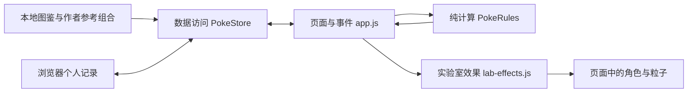

# 宝可梦发现室开发说明

这份说明帮助阅读和解释现有代码，不代表学生已经独立写出或理解全部实现。项目使用 AI 辅助，学习过程应通过本人阅读、手算、修改和实际验证补充。运行方法见 [README](../README.md)，资料采集口径见 [数据来源](数据来源.md)。

## 项目在解决什么问题

初学者可能认识皮卡丘，却看不懂六项能力和属性关系。发现室用初代 151 只角色的公开资料，把“认识角色 → 比较差异 → 动手试验 → 有预算地配队 → 保存自己的记录”连起来。它是浏览器单机应用，登录用来区分个人记录，网络多人服务是后续选项。

## 文件各做一件什么事

| 入口 | 职责 | 不负责的内容 |
|---|---|---|
| `index.html`、`css/style.css` | 页面骨架、脚本顺序、颜色、布局与动画样式 | 保存个人记录、决定倍率 |
| `js/data/catalog.js` | 本地公开图鉴快照：角色、属性和倍率表 | 随用户操作改变能力值 |
| `js/data/challenges.js` | 四支作者编排的只读参考组合 | 假扮其他玩家、保存个人队伍 |
| `js/data/store.js` | 通过 `PokeStore` 提供资料、登录、收藏、队伍和备份接口；集中读写 localStorage | 操作 DOM、播放动效 |
| `js/domain/rules.js` | 通过 `PokeRules` 计算倍率、队伍预算、统计和任务条件 | 读取浏览器存储、拼接页面 |
| `js/ui/app.js` | 接收点击和选择，调用数据与计算接口，更新页面和临时状态 | 直接读写 localStorage |
| `js/ui/lab-effects.js` | 播放、取消实验室 DOM 动效，照顾减少动态效果偏好 | 查倍率表、保存实验成绩 |
| `tools/build_catalog.py`、`assets/data/source-manifest.json` | 开发时整理公开资料，留下来源、时间和文件摘要 | 页面运行时下载实时资料 |
| `tests/*.test.cjs` | 检查数据与核心规则的预期行为 | 证明本人已经理解代码或完成试玩 |



箭头是数据流向，不表示规则模块会调用数据模块。页面先取得资料，再把需要的数组传给计算函数。经典脚本按 `index.html` 中的 `defer` 顺序执行，因此可以直接打开文件，无需打包工具；数据与计算必须先于页面入口准备好。

## 一条真实资料怎样变成页面

以下是当前 `catalog.js` 中皮卡丘记录的字段摘录，不是模拟用户数据：

```json
{
  "id": 25,
  "name": "皮卡丘",
  "slug": "pikachu",
  "height": 0.4,
  "weight": 6.0,
  "types": ["electric"],
  "stats": {
    "hp": 35,
    "attack": 55,
    "defense": 40,
    "special-attack": 50,
    "special-defense": 50,
    "speed": 90
  },
  "total": 320,
  "image": "assets/pokemon/25.png"
}
```

`id` 用来关联收藏、队伍和图片；`types` 用来筛选和计算防御倍率；六项 `stats` 生成能力条；`total` 是六项之和，也是本项目配队成本。身高和体重已从原单位转换成米和千克。能力是资料中的基础值，不是某一等级下的最终能力。

页面通过 `store.getCatalog()` 获得图鉴，再由 `card()` 把一条资料转成卡片。搜索时 `filtered()` 用 `filter()` 挑记录、用 `sort()` 排顺序，`updateGrid()` 更新结果。昵称和队伍备注等文字输出前经过 `escape()`，避免把用户输入当成 HTML。

## 属性实验室怎样工作

1. 用户选择一个攻击属性和一只目标宝可梦。左侧小精灵只代表攻击属性，目标从本地 151 只角色中选择。
2. 页面按目标编号取完整资料，自动读取它的一种或两种 `types`。用户不手动拼目标属性。
3. 点击发射时，页面调用 `rules.typeExperiment(attack, target.types, catalog.types)`。
4. 规则函数复用 `multiplier()`，返回各项因子、最终倍率和 `outcome`。`launchLab()` 先更新倍率、台词和场景上的结果类别，再调用 `PokeLabEffects.play()` 播放动画。
5. 计算过程默认折叠，需要时展开查看。更换攻击属性或目标回到准备状态，并取消旧动效，避免旧结果留在新目标上。
6. 下方的五题练习独立保留；实验发射本身不是答题，也不保存次数或成绩。

页面的 `labResult()` 负责结果文字，`labArenaHtml()` 负责场景，`labCalculationHtml()` 负责折叠公式；`updateLab()` 统一更新这三处。点击事件中的 `lab-fire` 分支调用 `launchLab()`。`attack-type` 与 `lab-target` 的 change 事件更新选择并进入准备状态；`example` 分支会选好预设属性与目标并立即发射。

例如岩石属性攻击喷火龙时，喷火龙资料中的防御属性为 `fire` 与 `flying`：

```js
rules.typeExperiment('rock', ['fire', 'flying'], catalog.types)
// {
//   attack: 'rock', defenses: ['fire', 'flying'],
//   factors: [2, 2], value: 4, outcome: 'weak'
// }
```

| 结果 | 判断顺序与条件 | 视觉表达 | 可手算的例子 |
|---|---|---|---|
| `immune` · 无效 | 先判断 `value === 0` | 攻击散落 | 电 → 小拳石：1 × 0 = 0 |
| `resist` · 抵抗 | 非零且 `value < 1` | 泡泡盾 | 火 → 喷火龙：0.5 × 1 = 0.5 |
| `neutral` · 普通 | `value === 1` | 轻晃 | 一般 → 皮卡丘：1 |
| `weak` · 弱点 | `value > 1` | 火花与轻跳 | 岩石 → 喷火龙：2 × 2 = 4 |

为什么只有一个攻击属性，却允许目标有两个属性？这里演示的是“一次单属性攻击”与“目标的防御属性”的关系。目标可以是双属性，因此要查两次表再相乘；攻击小精灵不代表一只要计算双属性出招的宝可梦。相加会让 2 × 0 本应无效的结果变成 2，改变原本的规则。

动效和文字使用同一个规则结果。`PokeLabEffects.play(arena)` 等待图片准备好后，读取发射源与目标的位置，把起点和位移写入 CSS 变量，再添加 `is-firing` 类；结果对应的具体效果由 CSS 决定。`stop()` 清除计时器与播放类，并递增播放序号，让尚未结束的图片准备失效。场景重绘时由页面替换装饰节点，效果模块不管理个人数据。

系统选择“减少动态效果”时，`play()` 跳过运动，文字结果仍然存在；图片准备失败也不应阻塞静态结果。没有先猜环节、血量、招式选择或随机胜负，倍率表示属性关系，不是伤害点数。

## 配队、任务和保存怎样连接

`draft` 保存正在编辑的成员编号，页面用编号取得资料后调用 `teamBudget()` 与 `analyzeTeam()`。总成本是每位成员基础能力总和相加；3000 点是项目自定预算，不是官方赛制。添加、保存和备份导入共享这条规则，避免出现“页面允许，导入却能绕过”的不一致。

`starterChallenge()` 观察当前草稿：6 位不重复成员、成本不超过 3000、电属性弱点成员不超过 2 位同时满足才完成。电弱点指防御倍率大于 1；任务不是新的保存门槛，完成也不会自动写成绩或保存队伍。

参考队伍来自作者设计的四支静态组合。将其载入编辑时复制成员编号，个人调整不修改原参考内容。对比只看当前搭配与选定参考或个人队伍的成员数、成本、平均能力和属性统计，不推算胜率。双属性成员可以在两类分布中各计一次；抵抗人数含免疫，六项能力平均值取整显示。

保存队伍调用 `store.saveTeam()`，数据层再次检查人数、编号、重复、预算和文字长度，登录后才写当前账号的记录。原有超预算队伍保留，可载入后调整；导入新备份时先检查全部内容，任何一支超预算都会拒绝整次导入，不部分覆盖当前记录。

## 哪些内容会保存

| 内容 | 放在哪里 | 刷新后的行为 |
|---|---|---|
| 公开图鉴、属性表、作者参考队伍 | 项目本地只读文件 | 仍可读取，不依赖运行时 API |
| 账号、当前登录会话、个人收藏、已保存队伍、五题练习成绩 | `store.js` 管理的 localStorage，键为 `poke-discovery-v1` | 同一浏览器和地址下保留 |
| 搜索筛选、对比选择、队伍草稿、实验攻击属性、目标编号、是否发射、练习当前进度 | `app.js` 内存变量 | 重新加载后回到初始状态 |
| 播放中的动效、计时和装饰节点 | 效果模块与当前页面 | 不写入个人记录；切换时清理 |
| JSON 备份 | 用户自行导出的文件 | 导入校验后替换当前账号记录，不包含密码 |

实验室临时状态分别是 `attack`（本次攻击属性）、`labTargetId`（目标编号）和 `labLaunched`（是否已发射）。初始为火属性、妙蛙种子、未发射；改变下拉选择将 `labLaunched` 设回 `false`，再次发射才揭示结果。效果模块的 `playNumber` 用来辨别新旧播放，`finishTimer` 控制结束清理，它们都不属于成绩。

五题练习完成时，登录用户通过 `savePractice(score, 5)` 保存成绩，最多保留最近 20 次；页面展示最近记录。访客可实验、练习和临时配队，个人保存需要登录。配队任务的即时完成状态由草稿重新计算，不另外存储。

## 边界与以后可以怎样扩展

- 本地登录用于展示记录隔离，密码保存在当前浏览器，不是服务端认证；`file://` 和 HTTP 地址的存储也分开。
- 收录范围是全国图鉴 001—151 的默认形态，属性口径是快照里的现行资料，不是第一世代旧规则。
- 属性计算不包含特性、招式、等级、个体值等机制，不输出实际伤害或胜率。
- 资料是开发时采集的本地快照；`master` 不是固定提交 SHA，详细来源和摘要见资料说明与清单。
- 网络版需要真实后端认证、权限与共享；现有 Promise 数据接口为替换数据访问实现留出位置，不能只增加一张排行榜冒充多人功能。

## 建议从哪几段代码讲起

先讲 `filtered()` 的筛选，再用 `multiplier()` 与 `typeExperiment()` 解释纯计算，接着追踪实验室事件与效果模块，最后讲 `teamBudget()`、`starterChallenge()` 和 `saveTeam()`。每次能用一条真实数据说明“输入是什么、怎么算、输出在哪里、是否保存”，就比逐行背整个文件更容易讲清楚。课堂练习见 [学习路线](学习路线.md)，演示安排见 [课堂汇报提纲](课堂汇报提纲.md)。
